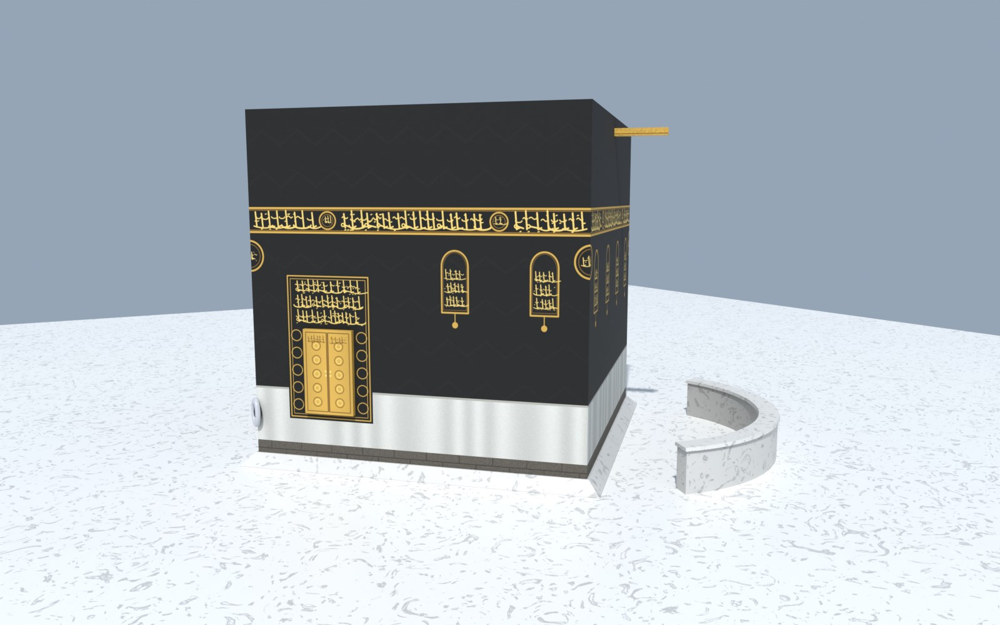

# Blender untuk Jejak Haji: model & render yang lebih realistik

Blender (percuma, https://www.blender.org) boleh menjadikan Jejak Haji lebih realistik dengan dua cara:

| Cara | Hasil | Dipakai di mana |
|---|---|---|
| **A. Model 3D masa nyata (.glb)** | Bangunan, Kaabah, jamrah dan lain-lain yang lebih terperinci | Terus di dalam paparan 3D game |
| **B. Render (Cycles / Eevee)** | Gambar atau video berkualiti tinggi | Skrin mula, kad bab, slaid kursus, video pengenalan |

Render Cycles terlalu berat untuk dijalankan secara langsung dalam pelayar. Jadi untuk **game**, gunakan cara A.
Untuk menjadikan model kelihatan "seperti render", **bake** pencahayaan ke dalam tekstur (langkah 4 di bawah).

---

## A. Model 3D untuk game (.glb)

### Contoh siap: Kaabah


Model Kaabah dalam game dibina sepenuhnya oleh skrip [`blender/kaabah.py`](../blender/kaabah.py): geometri, tekstur kiswah
(hizam, qanadil, sitara pintu, kain putih musim haji), Syazarwan, Hijir Ismail, Mizab dan Hajarul Aswad, kemudian
*bake* AO dengan Cycles dan eksport ke `models/kaabah.glb`. Fail sumber `models/kaabah.blend` boleh dibuka terus dalam Blender.

Jalankan semula selepas mengubah skrip:
```
blender --background --python blender/kaabah.py
JH_RENDER=1 blender --background --python blender/kaabah.py   # juga hasilkan models/kaabah-render.jpg
```
Tanpa Blender penuh, modul Python `bpy` (pip install bpy, perlukan Python 3.13 untuk bpy 5.x) juga boleh menjalankan skrip ini:
`python blender/kaabah.py`.

### 1. Sediakan projek Blender
- *Scene Properties → Units*: **Metric**, Unit Scale **1.0**. Dalam game, **1 m Blender = 1 unit 3D = 10 piksel peta 2D**.
- Paksi: **+X Blender = timur** (kanan peta 2D), **+Y Blender = utara** (atas peta 2D), **+Z = ke atas**.
- Letakkan **origin** objek di **tengah tapak** (aras lantai, Z = 0), kerana game meletakkan origin pada koordinat `x, y` yang anda tetapkan.

### 2. Saiz objek dalam game
Dunia game dikecilkan supaya muat dalam skrin, tetapi jemaah kekal setinggi ±1.8 m. Model boleh dibina mengikut ukuran sebenar,
kemudian dikecilkan dengan `scale` dalam konfigurasi.

| Objek | Lokasi (`scene`) | Kedudukan `x, y` | Ganti (`replace`) | Saiz dalam game | Cadangan `scale` jika model ikut saiz sebenar |
|---|---|---|---|---|---|
| Kaabah | `makkah` | `0, 0` | `"kaabah"` | tapak ±8.2 m, tinggi 8.6 m | ±0.66 (Kaabah sebenar ±13 m tinggi) |
| Maqam Ibrahim | `makkah` | `68, -68` | `"maqam"` | ±1.7 m lebar, ±3 m tinggi | 1 |
| Jamrah Ula / Wusta / Aqabah | `mina` | `400,-420` / `100,-420` / `-400,-420` | `"jamrah"` (menyembunyikan ketiga-tiganya) | takungan bujur 17 × 7.6 m | ikut takungan |
| Jabal Rahmah | `arafah` | `430, -330` | `"hill"` | 30 × 19 m, tinggi 12 m | — |

> **Awas:** `replace` menyembunyikan **semua** model asas jenis itu dalam lokasi tersebut. Contohnya `replace: "bld"` di Makkah
> menyembunyikan hotel dan kedai gunting sekali. Untuk jenis yang banyak (`bld`, `tent`, `palm`), lebih baik **tambah** model
> tanpa `replace`.

Kaabah dalam game diputar 45° supaya penjurunya menghala ke empat arah mata angin. Jika model Kaabah anda dibina dengan
dinding selari paksi X/Y, gunakan `rot: 45`.

### 3. Had prestasi (penting untuk telefon)
- **Segi tiga (triangles):** ±20 ribu bagi satu objek utama (Kaabah), ±100–150 ribu bagi semua model dalam satu lokasi.
  Semak dalam *Viewport Overlays → Statistics*. Gunakan modifier **Decimate** jika terlalu tinggi.
- **Tekstur:** 1024 × 1024 (atau 2048 untuk objek utama sahaja), format JPG untuk warna dan PNG hanya jika perlu lutsinar.
- **Saiz fail:** sasarkan kurang daripada 3–5 MB bagi setiap `.glb`. Jemaah mungkin menggunakan data mudah alih.
- Gunakan bahan **Principled BSDF** sahaja. Nod lain (contohnya prosedural) tidak dieksport. *Bake* nod tersebut kepada imej dahulu.

### 4. Supaya kelihatan realistik: *bake* pencahayaan
Game menggunakan pencahayaan ringkas. Untuk rupa seperti render:
1. Buka UV setiap objek (*UV → Smart UV Project*).
2. Tukar enjin ke **Cycles**, kemudian *Render Properties → Bake* dan pilih **Ambient Occlusion** (atau **Combined** untuk bayang penuh).
3. Bake ke imej baharu, kemudian darabkan (*MixRGB → Multiply*) imej itu dengan warna asal, atau bake **Diffuse + AO** terus menjadi satu tekstur.
4. Sambungkan imej hasil bake ke *Base Color* pada Principled BSDF.

Butiran halus seperti kaligrafi pada hizam kiswah, corak marmar, garisan saf di mataf dan tulisan pada papan tanda paling
berkesan jika dilukis atau dicetak terus ke dalam tekstur, bukan dimodelkan sebagai geometri.

### 5. Eksport
*File → Export → glTF 2.0 (.glb/.gltf)*:
- **Format:** glTF Binary (`.glb`)
- **Include:** *Selected Objects* (pilih objek yang hendak dieksport sahaja)
- **Transform:** *+Y Up* ditanda (lalai)
- **Data → Mesh:** *Apply Modifiers*, *UVs*, *Normals* ditanda
- **Data → Material:** *Export*; imej: *Automatic*
- **Compression (Draco): JANGAN ditanda.** Game belum memuat penyahkod Draco.
- **Animation:** tidak perlu ditanda (model statik)

Sebelum eksport, pilih objek dan jalankan *Object → Apply → All Transforms*.

### 6. Masukkan ke dalam game
1. Salin fail ke folder **`models/`** dalam repo, contohnya `models/kaabah.glb`.
2. Buka `src/00-config.ts`, cari `MODELS3D`, dan tambah satu baris:
   ```ts
   const MODELS3D: Model3D[] = [
     { scene: "makkah", file: "models/kaabah.glb", x: 0, y: 0, rot: 45, scale: 0.66, replace: "kaabah" },
   ];
   ```
3. Commit dan push ke `main`. GitHub Action akan membina game dan menerbitkan `index.html` bersama folder `models/` ke GitHub Pages.

### 7. Uji di komputer sendiri
Model `.glb` **tidak dapat** dimuat jika fail HTML dibuka terus (alamat `file://`). Jalankan pelayan web kecil dari folder repo:
```
npx -p typescript@5.9.3 tsc -p tsconfig.json
node build.mjs
python3 -m http.server 8000
```
Kemudian buka http://localhost:8000/index.html dan tekan butang **3D**.
Jika model tidak muncul, buka *Developer Tools → Console* dan cari mesej `Model 3D gagal dimuat`.
Jika model gagal dimuat, game tetap menggunakan model asas, jadi tiada apa-apa yang rosak.

### 8. Perkara yang perlu diketahui
- Model `.glb` hanya mengubah **rupa** dalam paparan 3D. Laluan berjalan, perlanggaran dan kedudukan interaksi masih
  mengikut peta 2D dalam `src/03-scenes.ts`. Pastikan model tidak menutup laluan atau titik interaksi.
- Paparan 2D tidak berubah.
- **Hak cipta:** bina model sendiri, atau gunakan aset berlesen bebas seperti **CC0** (contohnya tekstur dan HDRI di
  https://polyhaven.com) atau **CC-BY** (nyatakan kredit dalam *Rujukan*). Semak lesen setiap model yang dimuat turun,
  contohnya dari Sketchfab.

---

## B. Render untuk bahan visual

Render Cycles sesuai untuk:
- **Latar skrin mula** atau gambar setiap bab (contohnya Kaabah pada waktu senja, khemah Mina, dataran Arafah).
- **Video pengenalan** atau animasi laluan haji untuk kelas.
- **Slaid kursus haji** yang selari dengan rupa game.

Tetapan ringkas: *Render Engine → Cycles*, *Samples* 128–256 dengan *Denoise* ditanda, pencahayaan **HDRI** langit gurun
(*World → Environment Texture*), dan *Color Management → Filmic* atau *AgX*. Simpan sebagai JPG ±1600 px lebar untuk web.

Jika anda menyediakan imej render, letakkan dalam repo (contohnya `img/`). Kod game boleh dikemas kini untuk memaparkannya
sebagai latar skrin mula atau dalam kad penerangan bab.
